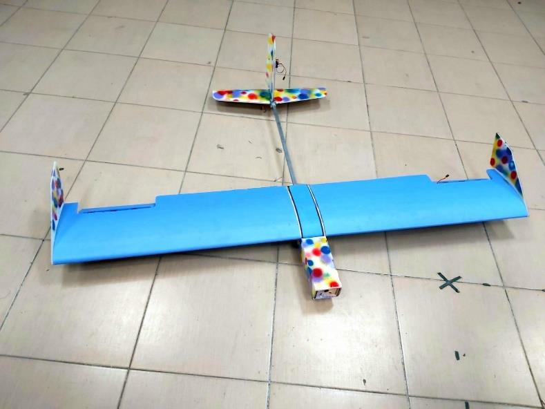

## Overview

A UAV capable of towing an advertising banner with the **minimum possible weight**, built in 2021 for the Design-Build-Fly competition held by the Unmanned Aerial Systems Development Center ([UDC](https://www.linkedin.com/company/udc-cairo-university/)) at Cairo University. We ranked **third**.

## My role

- Overall responsibility for the **aerodynamic analysis**.
- Designed the **release and deployment mechanism** of the banner.
- Took part in manufacturing: laser cutting for the fuselage and flat parts, and a hot-wire machine to cut the wing and tail.

## Why minimum weight?

Every gram of structure is a gram of lift, power and battery you have to provide. A light airframe lets a small motor tow the extra drag of a banner, but it also leaves less margin for the release mechanism and landing loads, so the aerodynamic analysis and the construction method had to be planned together.

## Full documentation

