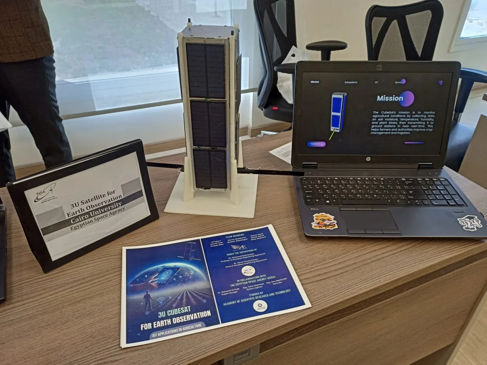

## Overview

Design and manufacturing of a **3U CubeSat for Internet-of-Things (IoT) applications** (2023-2024). The full report is embedded below.

## Sponsorship and supervision

This project was carried out **under the sponsorship of the Egyptian Space Agency (EgSA)**, with funding from the Academy of Scientific Research and Technology (ASRT). It was supervised by **Dr. Mohamed Khalil Ibrahim Iraqi**, who was Vice President of the Egyptian Space Agency and is now Head of the Aerospace Engineering Department at Cairo University.

## Mission

The satellite is meant to monitor agricultural conditions by collecting data on soil moisture, temperature, humidity and plant stress, then relaying it to ground stations in near real time, so that farmers and authorities can improve crop management and irrigation.

## The platform

A CubeSat is a small satellite built from standard 10 cm cubic units. A 3U CubeSat is three units long (roughly 10 x 10 x 34 cm) and typically weighs up to about 4 kg, which leaves room for a payload, a communication system, an on-board computer, a power subsystem and the structure that holds them together.

For an IoT mission the satellite acts as a relay in orbit: ground sensors in remote places send small packets up, and the satellite passes them down when it flies over a ground station.

## Antenna mechanism test

## Full documentation

