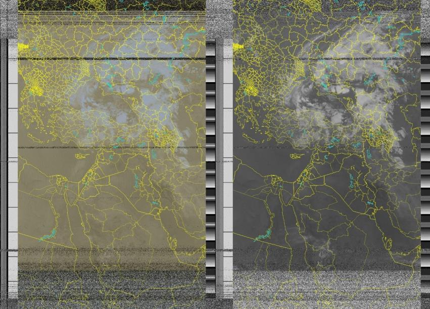

## Overview

The LEO Ground Station was our third-year project at Cairo University (2023). The goal: receive a real image from a satellite in low Earth orbit using hardware we designed and built ourselves.

It has three main parts:

1. **Propagator.** Our own orbit propagator based on the SGP4 model, which predicts when and where a satellite appears in the sky.
2. **Communication subsystem.** A Yagi antenna that we designed and manufactured.
3. **Rotator.** A two-degree-of-freedom rotator (azimuth and elevation) with a controller we implemented to point the antenna along the predicted track.

## Result

The system tracked the weather satellite **NOAA-18** and downloaded an image of Egypt.

## Full documentation

