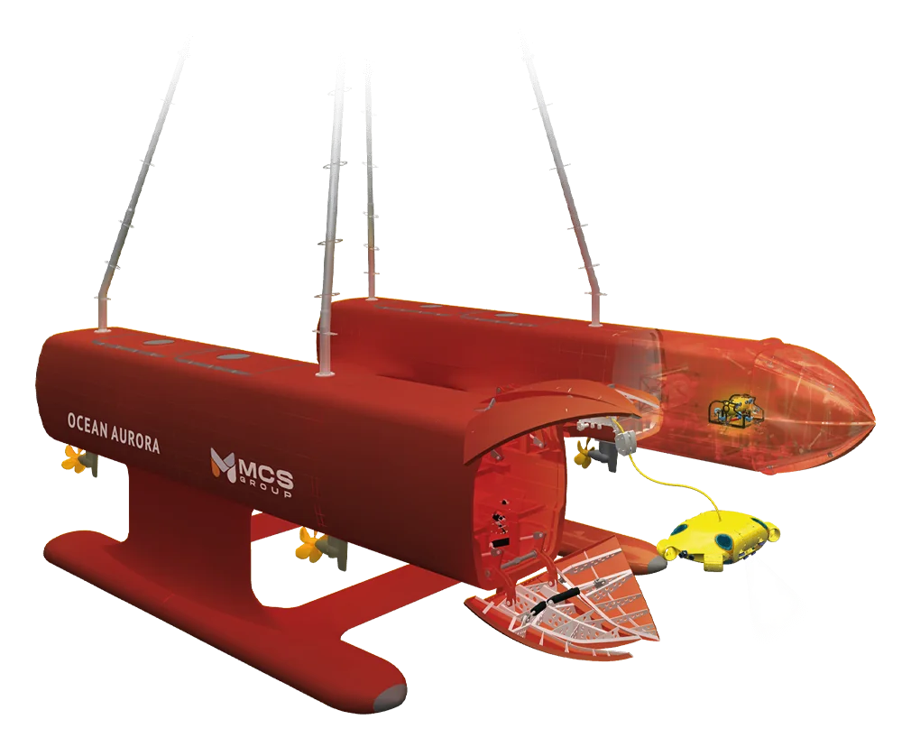

## Overview

RSV2 is one of the underwater vehicles I worked on at MCS Oil. My task was to develop its **complete drag matrix** using **Fossen's model**, covering the vehicle in each of its different operating modes.

The vehicle itself is presented on the MCS website: [Ocean Aurora](https://www.mcsoil.com/ocean-aurora/).

## Why a drag matrix?

A 6-DOF model of an underwater vehicle follows Fossen's formulation:

$$M\dot{\nu} + C(\nu)\nu + D(\nu)\nu + g(\eta) = \tau$$

where $\nu$ is the vector of body-fixed velocities (surge, sway, heave, roll, pitch, yaw), $M$ the mass including added mass, $C$ the Coriolis and centripetal terms, $g$ the restoring forces and $\tau$ the thruster forces and moments.

The damping term $D(\nu)$ is the **drag matrix**. It combines linear (viscous) and quadratic (pressure and form drag) contributions for every degree of freedom, and it is usually the least certain part of the model. A vehicle controller, a simulator or a thruster sizing study is only as good as this matrix.

## What I did

- Developed the complete drag matrix of RSV2 using Fossen's model.
- Covered the different operating modes of the vehicle, not just a single configuration.
- Supported thruster selection with the resulting drag data.

> Numerical results and models belong to MCS Oil and are not published on this page.
