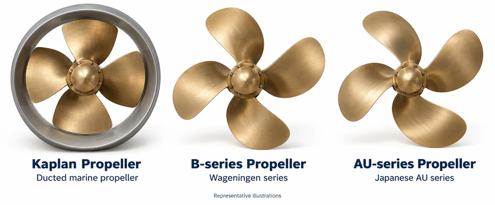

## Overview

MCS Oil develops its own in-house thruster code. My contribution is the **CAD-generation module**: it turns a propeller definition into a clean 3D model that can go straight into the design and simulation workflow.

The module covers three propeller families:

| Series | Where it is used |
| --- | --- |
| B-series | Wageningen B-series, the standard open-water, fixed-pitch propeller family |
| Kaplan | Ducted (nozzle) propellers, strong at high thrust and low speed |
| AU | Additional series supported by the in-house code |

## Why automate it?

Propeller geometry is defined by a handful of parameters: diameter, number of blades, pitch-to-diameter ratio and blade-area ratio, plus the series-specific section data. Building each variant by hand in CAD is slow and error-prone. A generator makes a parametric study (change the pitch ratio, regenerate, simulate again) a matter of minutes instead of hours.

## The propeller families

These are **representative illustrations only**. I am not showing real screenshots or models of the generated geometry because they are confidential to MCS Oil and cannot be shared.

## What I did

- Built the CAD-generation part of the in-house thruster code.
- Implemented geometry generation for the B-series, Kaplan and AU series.
- Worked on propeller selection, design and CAD modelling for thrusters.

> The code and its results belong to MCS Oil and are not published on this page.
